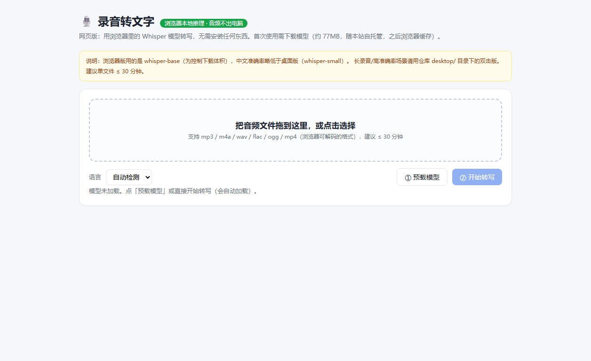
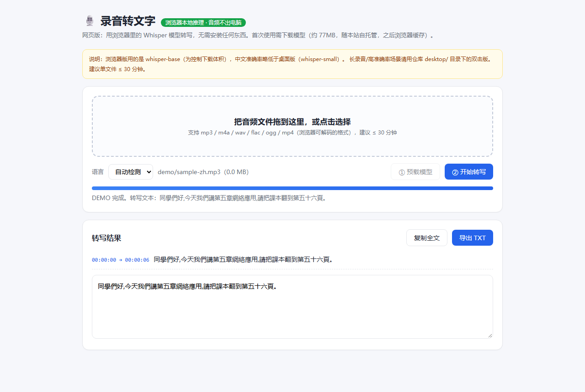

# 🎙️ 录音转文字工作台

把课堂录音、会议录音变成带时间轴的文字稿。**音频全程不出本机**，两种形态：

| 形态 | 引擎 | 适合场景 | 入口 |
|---|---|---|---|
| **网页版** | 浏览器内 Whisper（transformers.js，模型约 110MB，走 hf-mirror 镜像） | 零安装、任何电脑开箱即用 | **[GitHub Pages 在线版](https://openclawzhangchong.github.io/luyin-zhuan-wenzi/)**（[备用镜像](https://hazy-crystal-tqp9.here.now/)） |
| **桌面版**（推荐） | faster-whisper small（CPU int8，本机推理） | 长录音、高准确率、机房/办公机 | `desktop/启动录音转文字.bat` 双击 |

## 界面预览

打开 `index.html?demo=1` 自动演示：模型加载→内置样本转写：

## 功能

- 拖入音频（m4a/mp3/wav/flac/aac/ogg/mp4 等）→ 转写 → **带时间轴分段稿 + 全文**
- 导出 TXT / DOCX（桌面版）；TXT（网页版）
- 语言自动检测 / 中文 / English，中文输出偏置简体
- 历史记录留存与重复下载

## 隐私

- 网页版：模型从镜像下载到浏览器后，**推理全程在浏览器内**，音频文件不离开你的电脑
- 桌面版：模型在本机 `desktop/server/models/`，完全离线运行
- 仓库不含任何录音与转写稿

## 桌面版使用

1. 双击 `desktop/启动录音转文字.bat`（需 Python 3.10+）
2. 若首次运行提示模型缺失，运行 `desktop/下载模型.bat`（约 460MB，国内镜像，只需一次）
3. 拖入音频 → 开始转写 → 导出

> 桌面版 whisper-small 中文准确率与速度都优于网页版 whisper-base；30 分钟以上的长录音建议用桌面版。

## 已知适配

- faster-whisper 1.2.x 与新版 PyAV 的 `metadata_errors` 参数不兼容（PyAV ≥15 移除）——
  桌面版已改为自解码 16kHz float32 数组直喂模型，无需降级任何依赖。

技术栈：桌面版 Python/Flask + faster-whisper + PyAV；网页版 transformers.js + ONNX Runtime WASM。

## License

MIT © 2026 智策ZCagent
